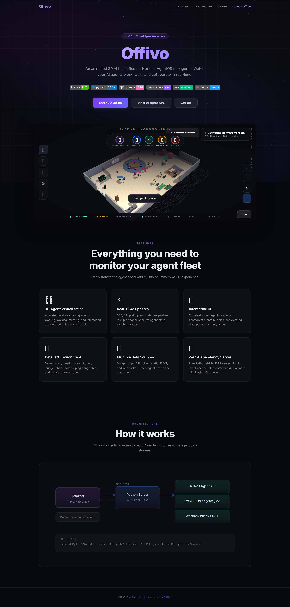
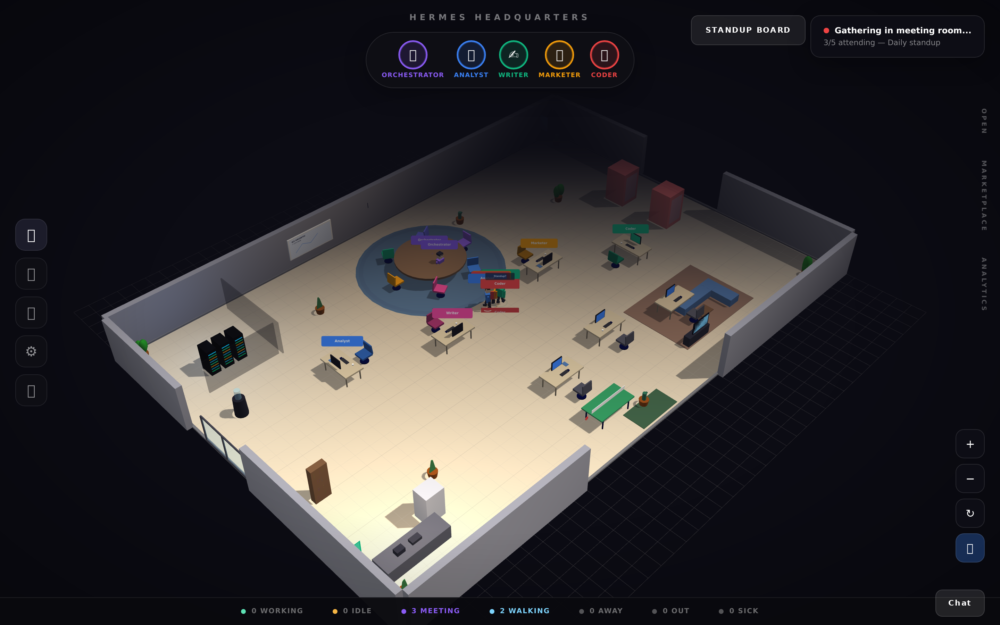

<div align="center">


# Offivo

*Formerly VirtOffice (hermes-3d-office).*

Virtual office platform — shared workspaces, video rooms, team chat, and collaborative document editing with Docker deployment.

[](https://github.com/OneByJorah/offivo/releases)
[](https://www.npmjs.com/package/offivo)
[](https://www.docker.com/)
[](https://opensource.org/licenses/MIT)

</div>




## What This Is

Virtual office platform — shared workspaces, video rooms, team chat, and collaborative document editing with Docker deployment.

## Quick Start

### npm

```bash
npm install offivo
```

### Docker

```bash
git clone https://github.com/OneByJorah/offivo.git
cd offivo
docker compose up -d
```

### From Source

```bash
git clone https://github.com/OneByJorah/offivo.git
cd offivo
npm install
npm run dev
```

## Features

- **Self-hosted** — run on your own hardware
- **Docker Compose** — full stack with one command
- **npm package** — install via npm
- **Dark theme** — operational UI

- **Shared workspaces** — virtual office spaces for teams
- **Video rooms** — WebRTC-based video conferencing
- **Team chat** — real-time messaging and channels
- **Document collaboration** — shared editing and comments
- **Docker Compose deployment** — multi-service stack
- **Dark theme** — modern, collaborative UI

## Package Badges

[](https://github.com/OneByJorah/offivo/releases)
[](https://www.npmjs.com/package/offivo)
[](https://www.docker.com/)
[](https://opensource.org/licenses/MIT)

## Contributing

[Open an issue](https://github.com/OneByJorah/offivo/issues) to report a bug or request a feature.

## License

MIT — see [LICENSE](LICENSE).
